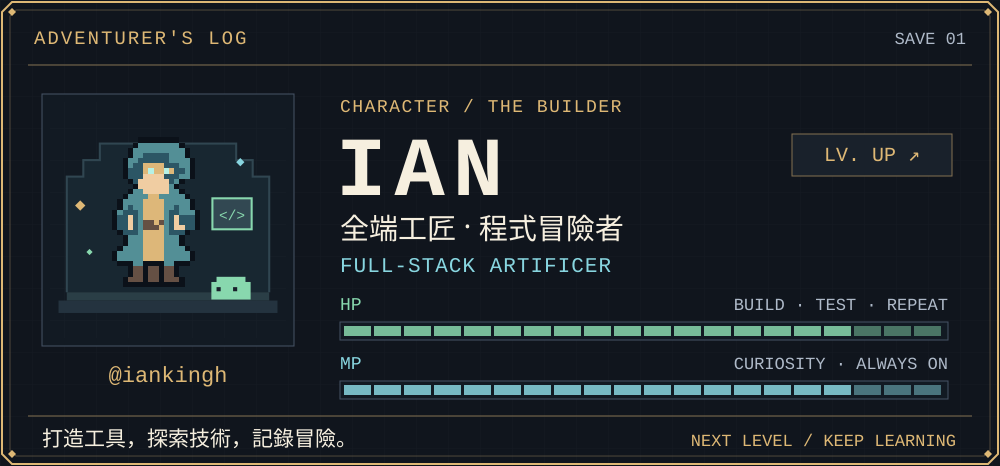
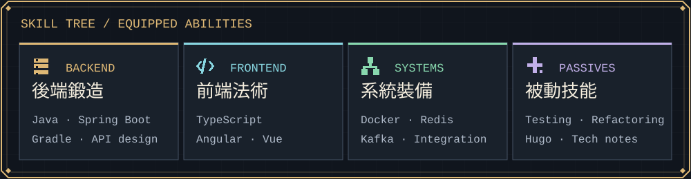
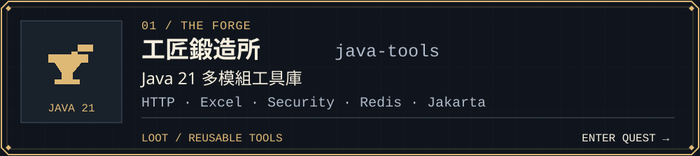
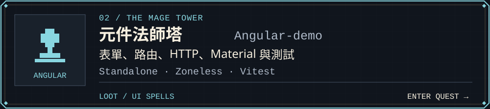
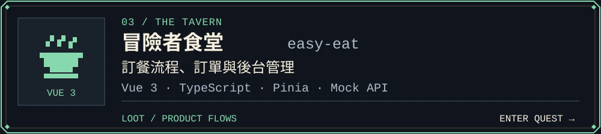
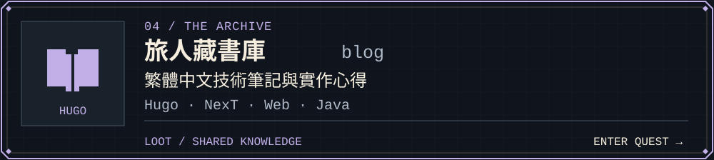

<picture>
  <source media="(max-width: 600px)" srcset="assets/rpg/character-mobile.svg">
  
</picture>

  <a href="#skill-tree--技能樹">技能樹</a> ·
  <a href="#main-quests--主線副本">主線副本</a> ·
  <a href="#quest-log--任務紀錄">任務紀錄</a> ·
  <a href="#world-map--世界地圖">世界地圖</a>

我是 **Ian**，一位把想法鍛造成實用工具的開發者。冒險範圍從 Angular、Vue 的前端介面，到 Java 函式庫與 Spring Boot 整合；沿途的心得，寫進繁體中文技術筆記。

*A code adventurer crafting practical web applications, Java libraries, and reusable tools.*

## Skill tree / 技能樹

<picture>
  <source media="(max-width: 600px)" srcset="assets/rpg/skills-mobile.svg">
  
</picture>

**裝備欄**　`Java` · `Spring Boot` · `Gradle` · `TypeScript` · `Angular` · `Vue` · `Docker` · `Redis` · `Kafka` · `Hugo`

## Main quests / 主線副本

每張卡片都是一個可以探索的專案，點擊即可進入原始碼。

<a href="https://github.com/iankingh/java-tools">
  <picture>
    <source media="(max-width: 600px)" srcset="assets/rpg/forge-mobile.svg">
    
  </picture>
</a>

<a href="https://github.com/iankingh/angular-examples">
  <picture>
    <source media="(max-width: 600px)" srcset="assets/rpg/tower-mobile.svg">
    
  </picture>
</a>

<a href="https://github.com/iankingh/easy-eat">
  <picture>
    <source media="(max-width: 600px)" srcset="assets/rpg/tavern-mobile.svg">
    
  </picture>
</a>

<a href="https://github.com/iankingh/blog">
  <picture>
    <source media="(max-width: 600px)" srcset="assets/rpg/archive-mobile.svg">
    
  </picture>
</a>

## Quest log / 任務紀錄

- **⚒️ 鍛造可重用元件**　`ONGOING` 
  安全預設、清楚的 API 與邊界測試。
- **🔮 探索現代前端**　`ONGOING` 
  Angular components、Vue 產品流程與型別設計。
- **📜 編寫冒險筆記**　`ONGOING` 
  將實作心得整理成可重現的繁體中文文章。

> **被動技能：持續學習。** 每一次重構、測試和紀錄，都是下一次冒險的裝備。

## World map / 世界地圖

<strong>🌲 前端森林 — Web &amp; frontend</strong>

| 地點 | 探索內容 |
| --- | --- |
| [angular-examples](https://github.com/iankingh/angular-examples) | Angular 表單、HTTP、路由、Material 與測試 |
| [easy-eat](https://github.com/iankingh/easy-eat) | Vue 3 訂餐流程與 Mock API |
| [javascript-examples](https://github.com/iankingh/javascript-examples) | ES6、非同步、DOM、Fetch 與圖片處理 |
| [vue-examples](https://github.com/iankingh/vue-examples) | Vue 3 Composition API 範例；[vue2 分支](https://github.com/iankingh/vue-examples/tree/vue2) 保留歷史教材 |
| [ng-advanced-210410](https://github.com/iankingh/ng-advanced-210410) | Angular 22 進階課程與 dashboard 練習 |

<strong>⛰️ 後端山脈 — Java &amp; integrations</strong>

| 地點 | 探索內容 |
| --- | --- |
| [java-tools](https://github.com/iankingh/java-tools) | Java 21 多模組工具庫 |
| [spring-boot-redis-example](https://github.com/iankingh/spring-boot-redis-example) | Spring Boot、Redis 與 Docker Compose 整合 |
| [spring-boot-demo](https://github.com/iankingh/spring-boot-demo) | 保留版本基線的 Spring Boot 範例集合 |
| [spring-boot-kafka](https://github.com/iankingh/spring-boot-kafka) | Kafka producer、consumer、partition 與 consumer group |

<strong>⚔️ 訓練場 — Algorithms &amp; practice</strong>

| 地點 | 探索內容 |
| --- | --- |
| [leetcode-java](https://github.com/iankingh/leetcode-java) | Java 解題與演算法練習 |
| [java-design-patterns](https://github.com/iankingh/java-design-patterns) | 設計模式學習的 Java 起始 workspace |

<strong>🏰 知識城鎮 — Writing &amp; publishing</strong>

| 地點 | 探索內容 |
| --- | --- |
| [blog](https://github.com/iankingh/blog) | 繁體中文技術筆記的 Hugo 原始碼 |
| [hugo-theme-next-starter](https://github.com/iankingh/hugo-theme-next-starter) | Hugo NexT starter 與設定 |
| [iankingh.github.io](https://github.com/iankingh/iankingh.github.io) | 個人網站的 GitHub Pages 入口 |

---

  <strong>✦ 下一站，繼續冒險。 ✦</strong> 
  <a href="https://iankingh.github.io/blog/">📖 閱讀技術筆記</a> ·
  <a href="https://github.com/iankingh?tab=repositories">🗺️ 探索所有專案</a>

